# Architecture Overview

`donate-socket` is a cross-platform desktop application designed for livestreamers. It connects real-time TikTok LIVE gifts and chat, Text-to-Speech (TTS), and Spotify playback state to external webhooks and interactive OBS overlay systems.

---

## High-Level Architecture Diagram

```mermaid
graph TD
    subgraph Frontend ["Frontend UI (Tauri Webview / LAN Vite)"]
        UI["React 19 + TypeScript + Vite"]
        I18n["src/i18n.tsx (EN / TH Switcher)"]
        SrcLib["src/lib/ (apiBase.ts, screenShareClient.ts)"]
        Sidebar["Sidebar (Nav, Lang, Status, Bridge)"]
        Dash["Dashboard Tab: Spotify, Chat/TTS, Logs"]
        Config["Configuration Tab: TikTok, Split Webhooks, Spotify"]
        Overlays["Overlays Market Tab"]
        Studio["Overlay Studio Tab & Scene Profiles"]
        ScreenShare["Screen Share Tab: WHIP & HTTPS URLs"]
        About["About Tab & GitHub Update Checker"]
    end

    subgraph DesktopShell ["Tauri v2 Desktop Shell (Rust)"]
        MainRs["src-tauri/src/main.rs"]
        LibRs["src-tauri/src/lib.rs"]
        Spawn["spawn_server(), apiRevision check, BackendProcess"]
    end

    subgraph Backend ["Backend HTTP & Event Bridge (0.0.0.0:3001)"]
        Server["server/index.ts (CORS & HTTP)"]
        Utils["server/utils.ts (LAN, SSRF, JSON, escapeHtml)"]
        State["server/state.ts (State + SSE)"]
        ConfigMgr["server/config.ts (Atomic YAML + Migration)"]

        subgraph Services ["Services"]
            TikTokSvc["server/services/tiktok.ts"]
            SpotifySvc["server/services/spotify.ts"]
            WebhookSvc["server/services/webhook.ts"]
            TtsSvc["server/services/tts.ts"]
            OverlaySvc["server/services/overlays.ts"]
            ScreenSvc["server/services/screenShare.ts (0.0.0.0:3002)"]
            TlsSvc["server/services/tlsCert.ts"]
        end

        subgraph Routes ["Modular Route Handlers"]
            TikTokRoutes["server/routes/tiktok.ts"]
            SpotifyRoutes["server/routes/spotify.ts"]
            StatusRoutes["server/routes/status.ts"]
            TtsRoutes["server/routes/tts.ts"]
            OverlayRoutes["server/routes/overlays.ts"]
            ScreenRoutes["server/routes/screenShare.ts"]
        end
    end

    subgraph External ["External Services & OBS"]
        TikTokLive["TikTok LIVE Servers"]
        SpotifyAPI["Spotify Web API"]
        EdgeTTS["Microsoft Edge TTS"]
        WebhookEndpoint["Split Webhook Targets"]
        OBSSource["OBS Browser Source / Overlay Studio / Screen Share"]
        WhipSender["LAN WHIP Sender (OBS / Browser HTTPS / GStreamer)"]
    end

    UI -->|HTTP REST & SSE /api/events| Backend
    DesktopShell -->|Spawns on launch| Backend
    TikTokSvc -->|Webcast Push + 30s Polling| TikTokLive
    SpotifySvc -->|OAuth & Player / Queue API| SpotifyAPI
    TtsSvc -->|Audio Synthesis| EdgeTTS
    WebhookSvc -->|HTTP POST JSON| WebhookEndpoint
    OBSSource -->|SSE & Overlays| OverlayRoutes
    WhipSender -->|HTTP/HTTPS WHIP & WebRTC| ScreenSvc
```

---

## Core Components

### 1. Tauri v2 Desktop Wrapper (`src-tauri/`)
- **Framework**: Tauri v2 (`donate-socket`, `zip.kizuna.donate`).
- **Process Management**: On desktop launch, `src-tauri/src/lib.rs` executes `spawn_server()`, detects and terminates outdated backend processes on port `3001` (`EXPECTED_SCREEN_SHARE_REVISION` check), tracks managed child processes in `BackendProcess` for shutdown cleanup (`stop_managed_server`), and launches the compiled backend (or `bun server/index.ts` in dev) with `CREATE_NO_WINDOW` on Windows.
- **Packaged Config Resolution**: Resolves OS config locations (`%APPDATA%\dethz-lab\dethz-socket\config.yaml` on Windows via `resolve_config_dir()`, migrating legacy `zip.kizuna.donate\config.yaml` once via `migrate_legacy_config()`), passing `DONATE_CONFIG_FILE` and `DONATE_CONFIG_TEMPLATE` to the backend.

### 2. Backend Bridge Service (`server/`)
The backend is a modular TypeScript service listening on `0.0.0.0:3001` (LAN + loopback, configurable via `HOST` / `PORT`):
- **`server/index.ts`**: HTTP server enforcing `isAllowedOrigin()` CORS allowlists (Tauri webviews, loopback, and private/LAN origins via `isPrivateOrLanHost()`, blocking untrusted external browser requests to `/api/*`).
- **`server/utils.ts`**: Shared `HOST` / `PORT` defaults, `getLanAddresses()`, `isPrivateOrLanHost()`, `isLoopbackAddress()`, `isSelfTargetHost()`, `classifyBlockedHost()`, `escapeHtml()`, bounded `parseJsonBody()` with `req.destroy()`, and JSON response helpers.
- **`server/state.ts`**: In-memory application state and real-time Server-Sent Events (SSE) broadcaster (`/api/status/stream` and `/api/events`).
- **`server/config.ts`**: Atomic YAML configuration persistence (`config.yaml`), legacy JSON migration, split webhook settings, role-based access settings, `screen_share` configuration + token masking, external iframe URL filtering, and Studio master/profile scene normalization.
- **`server/services/`**:
  - `tiktok.ts`: Integrates with `tiktok-live-connector`, polls `fetchIsLive()` every 30s (`LIVE_CHECK_INTERVAL_MS`) while offline, debounces combo gifts (with 3.5s timeout fallback), tracks chat roles (`owner`, `moderator`, `subscriber`, `follower`, `guest`), runs single-pass TTS placeholder substitution, and handles `!sr` / `!songrequest` / `!request` / `!song` chat commands.
  - `spotify.ts`: Manages OAuth token refresh, playback state polling, queue/device discovery, song search/queueing, and song-change webhook dispatch.
  - `webhook.ts`: Validates destination URLs (`validateWebhookUrl()` + `classifyBlockedHost()` / `isSelfTargetHost()`), disables HTTP redirects (`redirect: "error"`), routes by event type (`webhook.uri`, `webhook.uri_chat`, `webhook.uri_spotify`), and retains up to 50 log entries per type (250 total).
  - `tts.ts`: Lists voices and synthesizes `audio/mpeg` speech via `msedge-tts`, enforcing voice/rate/pitch SSML sanitization and a `1000`-char text limit.
  - `overlays.ts`: Hosts static overlays, manages presets, scaffolds custom widgets with HTML escaping, imports Git/ZIP overlays safely (`validateRemoteRepoUrl`, `execFile`, manual validated redirects, symlink skip + boundary checks), and drives Overlay Studio master and named profile scenes.
  - `screenShare.ts` & `tlsCert.ts`: Runs a same-port HTTP + self-signed HTTPS (`prime256v1` X.509 cert persisted alongside `config.yaml`) TCP multiplexer on `0.0.0.0:3002` for RFC 9725 WHIP WebRTC screen sharing (`POST /whip`, `PATCH`, `DELETE`), built-in `/share` sharer UI, masked `obs` SSE status broadcasts, and 50-peer cap.
- **`server/routes/`**: Modular REST and SSE route handlers in `tiktok.ts`, `spotify.ts`, `status.ts`, `tts.ts`, `overlays.ts` (with loopback-restricted `/api/overlays/open-folder`), and `screenShare.ts` registered via `server/routes/index.ts`.

### 3. Frontend Application (`src/`)
- **Technology**: React 19, TypeScript, Vite (`0.0.0.0:1420` dev / `4173` preview), `src/lib/apiBase.ts` (dynamic `API_BASE` for Tauri vs LAN), `src/lib/screenShareClient.ts`, and `src/i18n.tsx` (`LangProvider`, `EN` / `ไทย` dictionaries persisted to `localStorage`).
- **Design System**: RawBlock brutalism (`0px` border-radius, `3px` / `5px` structural borders, zero drop shadows, Catppuccin Macchiato palette with Sapphire `#7dc4e4`, and `IBM Plex Sans Thai` fallback font).
- **Navigation Tabs (`src/components/Sidebar.tsx`)**:
  - **Dashboard**: Live TikTok stream status, interactive Spotify player/queue/device selector, song request tools, live TikTok chat reader + TTS controls, dispatch previews, and filtered webhook logs (**ALL / GIFT / TTS / SPOTIFY**).
  - **Configuration**: TikTok username, split webhook endpoints (`uri`, `uri_chat`, `uri_spotify`), Spotify Client ID/Secret OAuth linking, and webhook test triggers.
  - **Overlays**: In-app Marketplace presets, custom overlay scaffolding, Git/ZIP import, and 1-click OBS URL copy.
  - **Overlay Studio**: Interactive canvas composer with external HTTP/HTTPS iframe layers, named scene profiles (`?profile=<id>`), editor share links, and TikTok LIVE danger zone overlays.
  - **Screen Share**: Live WebRTC preview, audio/fit/fullscreen controls, WHIP port & Bearer token management, LAN & HTTPS `/share` URLs, and `/overlays/screen-share/` OBS Browser Source link.
  - **About**: Build version (`__APP_VERSION__`) and on-demand/launch GitHub release update check (`AboutTab.tsx`).
